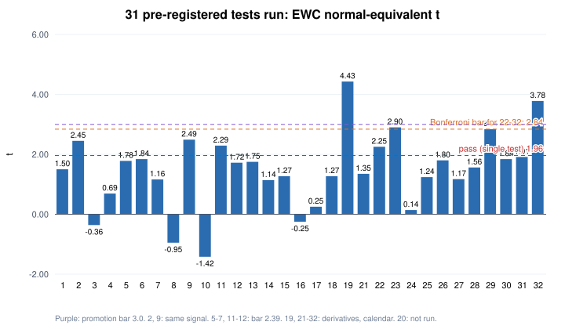
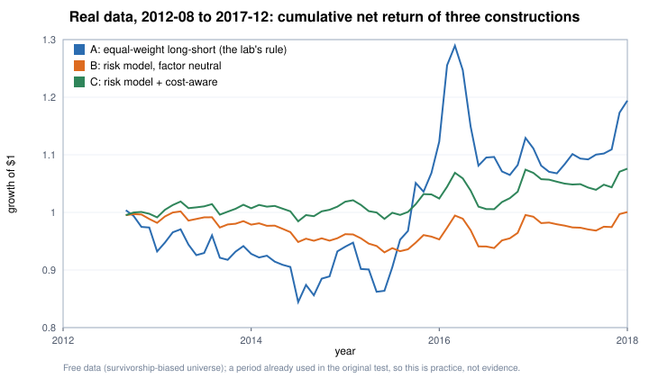

# Quant Research Lab — a pre-registered factor research pipeline, and what it taught me

A personal research lab for US equities that tries to answer one question honestly:
**which return signals survive costs when you test them the way a careful buy-side researcher would?**

The short answer after 18 pre-registered tests: **one signal survived, weakly** (a composite of eight classic mispricing anomalies, EWC-equivalent t ≈ 2.5),
and the long–short portfolio built on it has a backtest Sharpe ratio of about **0.55** with a **−40 %** maximum drawdown — useful as evidence, mediocre as a product.
The rest of this repository explains how that conclusion was reached, why most ideas failed, and the standard quant toolkit
(risk models, optimization, ML validation, execution, options) rebuilt from scratch in NumPy.

> Status: research and paper trading only. Nothing here is investment advice.

---

## What is in here

| Part | What it shows | Where |
|---|---|---|
| **1. Research process** | Pre-registration, multiple-testing control, power analysis, HAC inference (EWC / Newey–West), survivorship-bias correction, an append-only test registry, and a shadow (paper) portfolio with a rehearsed monthly runbook | [`docs/01_research_process.md`](docs/01_research_process.md), `quantlab/factor_test.py` (the test itself, validated by simulation) |
| **2. Risk model & portfolio optimization** | Barra-style factor risk model, Ledoit–Wolf shrinkage, an ADMM optimizer with neutrality constraints, position limits and transaction costs — on synthetic data **and applied to the surviving signal on real 2012–2017 data** | [`docs/02_risk_model_and_optimization.md`](docs/02_risk_model_and_optimization.md), `quantlab/risk_model.py`, `quantlab/optimizer.py` |
| **3. Machine learning & overfitting** | Histogram gradient-boosted trees, purged / embargoed cross-validation, Newey–West t-stats, the deflated Sharpe ratio — and a walk-forward test **on real stocks** against the simple composite | [`docs/03_ml_and_overfitting.md`](docs/03_ml_and_overfitting.md), `quantlab/gbdt.py`, `quantlab/validation.py` |
| **4. Execution & transaction costs** | Square-root impact, Almgren–Chriss optimal execution, implementation-shortfall TCA, strategy capacity — recomputed **with the stocks the portfolio actually traded** | [`docs/04_execution_and_costs.md`](docs/04_execution_and_costs.md), `quantlab/execution.py` |
| **5. Options, probability & market making** | Black–Scholes and Greeks, binomial trees, implied volatility, delta-hedging P&L, Kelly sizing, a Glosten–Milgrom market-making simulation, classic probability puzzles — plus **the variance risk premium on real 2010–2017 data** | [`docs/05_options_and_market_making.md`](docs/05_options_and_market_making.md), `quantlab/options.py`, `quantlab/probability.py` |

Every module in `quantlab/` has a self-test that checks it against an independent answer
(closed form vs. numerical solution, brute-force enumeration, finite differences, or Monte Carlo). Run them all, and regenerate every figure, with:

```bash
pip install numpy
python run_selftests.py
python make_figures.py
```

Parts 2–5 first check each method on **synthetic data with a known ground truth**, then apply it to **real data from 2010–2017**
(the years after 2017 are reserved for confirming pre-registered tests). Only aggregate results — monthly portfolio returns, ICs, cost curves, strategy P&L — are included, in `data/`;
no market data is redistributed.

---

## Headline results (Part 1)

18 hypotheses were registered before any data was examined; each had a fixed threshold, test statistic and budget.



| # | Signal (US large/mid caps unless noted) | Result | Main statistic |
|---|---|---|---|
| 1 | Year-over-year change in 10-K text | fail | NW t 1.85 (threshold 1.96) |
| 2 | **Mispricing composite (8 anomalies)** | **pass** | IC 0.021, EWC t **2.45** |
| 3 | Value composite (B/M, E/P, C/P) | fail | EWC t −0.36 |
| 4 | Residual momentum | fail | EWC t 0.69 |
| 5–7 | Mined in 2010–17, confirmed on 2018–26: 10-K filing lag, leverage, change in leverage | fail | EWC t 1.78 / 1.84 / 1.16 (threshold 2.39) |
| 8 | Opportunistic insider trading | fail | EWC t −0.95 |
| 9 | **#2 re-run on survivorship-bias-free data, rules unchanged** | **pass** | IC 0.023, EWC t **2.49** |
| 10 | Calendar composite (earnings-announcement premium + seasonality) | fail | EWC t −1.42 |
| 11–12 | Second mining round: 8-K filing frequency, stock-price synchronicity | fail | EWC t 2.29 / 1.72 (threshold 2.39) |
| 13 | Literature composite (geographic dispersion, industry concentration, employee growth) | fail | EWC t 1.75 |
| 14 | #2 applied to small caps | fail | EWC t 1.14; negative after small-cap costs |
| 15 | Cross-asset ETF trend following | fail | EWC t 1.27 |
| 16 | Cross-asset carry + value + low-beta composite | fail | EWC t −0.25 |
| 17 | Macro composite (economic trend, carry timing, seasonality) | fail | EWC t 0.25 |
| 18 | Merger arbitrage (cash deals, identified from SEC filings) | fail | EWC t 1.27; market beta 0.60 explained the return |

**The portfolio built on the surviving signal** (50 long / 50 short, equal weight, monthly, 2012-08 → 2026-07, net of 0.2 % one-way costs and 1 %/yr borrow):

| | Sharpe | CAGR | Volatility | Max drawdown |
|---|---|---|---|---|
| Long–short portfolio | 0.55 | 8.1 % | 16.5 % | −39.8 % |
| S&P 500 (SPY, same period) | 0.90 | 14.9 % | 14.9 % | −23.8 % |

- With 14 years of data the 95 % interval for that Sharpe ratio is roughly **0 to 1.1** — the backtest cannot distinguish "0.55" from "close to zero".
- The equal-weight construction leaves large unintended exposures: in a rehearsal of the live process the portfolio's ex-ante market beta was about **−1.4**, outside anything seen in the backtest.
- **Applying a risk model to the same signal on real 2012–2017 data** (Part 2): 57 % of the equal-weight portfolio's predicted risk was factor risk. Neutralising it cut volatility
  from 11.5 % to 3.7 % and the maximum drawdown from −17 % to −6 %, and raised the Sharpe ratio before costs from 0.60 to 0.83 — but after costs only from 0.34 to 0.38,
  and a cost-blind optimizer gave everything back (0.02). On real data the gain is mostly risk reduction, and cost-awareness is not optional.



## What I took away

1. **Most ideas fail when tested honestly.** One signal survived (tests #2 and its survivorship-free re-run #9); everything else failed. The machinery that produced that number — pre-registration, a registry of every test,
   an exploration / confirmation split, HAC standard errors, power analysis — is the real deliverable.
2. **Construction matters as much as the signal.** On synthetic data, the same weak signal goes from an information ratio of 0.7–1.5 (equal-weight long–short)
   to 1.6–2.7 (factor-neutral, risk-model-optimized), and cost-aware optimization cuts turnover by about four-fifths. On real data the same machinery mainly removed risk
   (volatility down by two-thirds) — a more modest, more realistic result.
3. **Validation is where ML goes wrong.** Shuffled K-fold CV on pure noise with overlapping labels produced an IC of 0.21 (Newey–West t ≈ 27); purged, time-ordered validation gave ≈ 0.
   On real stocks, properly validated ridge and boosted trees did not beat simply averaging the eight anomalies (IC −0.014 and +0.006 vs +0.025) and traded two to three times as much.
4. **Costs set capacity.** With the liquidity of the stocks the strategy actually traded, costs are small at personal scale but consume about half its gross return at roughly $100 m per side.
5. **Selling volatility pays — until it doesn't.** On 2010–2017 data, selling one-month S&P 500 variance at the VIX earned money in 86 % of months (Sharpe 2.0),
   with skewness −3.3 and single months losing as much as nine average months.

## License

MIT — see [LICENSE](LICENSE).
