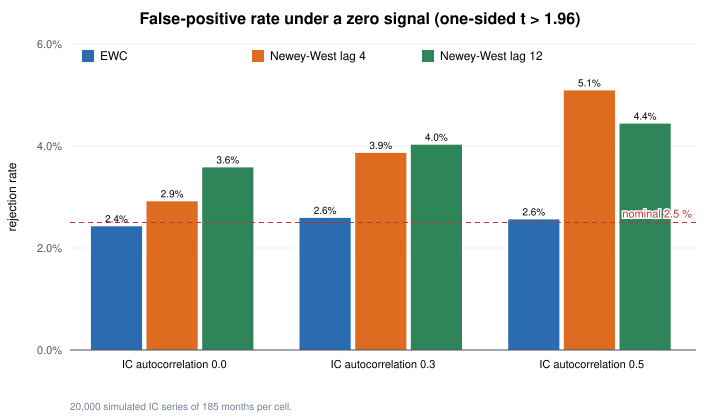

# Part 1 — The research process

This part describes how hypotheses were tested. The pipeline itself (data collection, point-in-time joins, the frozen test framework, the shadow portfolio)
lives in a private repository because it touches licensed data; this write-up covers the design, the rules and the results. Only aggregate statistics are reported.

## 1. Universe and data

- **Universe** (rebuilt every month, point in time): US companies that filed a 10-K in the previous 400 days (including firms that later delisted),
  listed on NYSE or Nasdaq, price ≥ $5, 60-day median dollar volume ≥ $10 m, market capitalisation ≥ $1 bn, excluding foreign filers and non-operating entities
  (SPACs, trusts, funds). About 1,000–1,500 stocks per month; financials are excluded for accounting-based signals.
- **Fundamentals** come from SEC EDGAR XBRL, aligned on the **filing date** (when the market could actually see the number), never on the fiscal period end.
- **Prices**: free daily data first; from test #9 on, a licensed survivorship-bias-free database (including delisted stocks and delisting returns) was used for re-runs.
- **Data gates fixed in advance**: daily |return| > 100 % is treated as a data error; stale prices, missing listings and penny stocks are excluded by the universe rules
  (an earlier sister project had an over-the-counter stock print a +499,900 % day that wrecked an equal-weight benchmark).

## 2. Timing (no look-ahead)

- Signal month *m*: the signal uses only information available by the close of the **last trading day L** of the month (prices up to L; filings with filing date ≤ L).
- Positions are traded at the **close of the next trading day T1** and held to the next month's T1 close.
- Real-money orders would be market-on-close orders on T1, so the backtest's fill price and the live fill price are the same price.

## 3. Pre-registration

Before any data for a hypothesis was downloaded, a pre-registration file was committed to git (the commit hash is the proof). It fixes:

- the economic hypothesis and the literature it relies on;
- the exact signal definition, universe, timing and data sources;
- the test statistic, the threshold, minimum coverage (≥ 120 months, ≥ 200 stocks per month), and what counts as "pass", "fail" or "unusable";
- the **power analysis** (below) and the expected **direction of known biases** (e.g. "missing delisted firms biases this effect upward / downward / unclear");
- what happens after a pass or a fail. **A failed line is closed; it is never re-tested with a different definition.**

## 4. The test framework (frozen)

- For each month, the **cross-sectional Spearman rank IC** between the signal and next-month excess returns; quintile portfolios; a long–short spread net of
  one-way costs of 0.2 % (and 1 %/yr borrow for the short side).
- **Main statistic: the EWC-equivalent t** of the mean IC (equal-weighted cosine HAC estimator, Lazarus, Lewis, Stock & Watson 2018,
  with ν = ⌊0.4·T^(2/3)⌋ degrees of freedom, converted to a normal-equivalent t). Newey–West is reported alongside.
  Monthly ICs are autocorrelated (slow-moving characteristics), so plain t-statistics overstate significance.
- The framework was validated on **synthetic data** (false-positive rate under a zero signal, power under injected signals) and then **frozen**:
  its file hashes are checked by an automated test, and any change means a new version.
- Portfolio-level strategies (cross-asset, event-driven) use the same idea on monthly net excess returns ("returns framework", also validated on synthetic data).

### How the test was validated (`quantlab/factor_test.py`)

The public version of the test (`factor_test()`: IC, quintiles, net long–short spread, EWC and Newey–West, coverage rules and a look-ahead guard)
comes with the same simulations that justified the choice of EWC. Run `python -m quantlab.factor_test`.

False-positive rate with **no signal at all** (20,000 simulated IC series of 185 months, monthly IC std 0.06, AR(1) autocorrelation ρ; one-sided t > 1.96, nominal 2.5 %):

| IC autocorrelation ρ | EWC | Newey–West, lag 4 | Newey–West, lag 12 |
|---|---|---|---|
| 0.0 | 2.43 % | 2.92 % | 3.58 % |
| 0.3 | 2.59 % | 3.86 % | 4.03 % |
| 0.5 | 2.56 % | 5.09 % | 4.44 % |

Newey–West with normal critical values rejects up to twice as often as it should once ICs are autocorrelated; EWC stays at the nominal level.
The price is some power, which the pre-registration's power analysis accounts for. Power to reach the **promotion** bar (EWC t > 3; ρ = 0.3, so the long-run IC std is 0.082):

| True mean IC | Simulated (4,000 runs) | Formula |
|---|---|---|
| 0.01 | 5.6 % | 5.4 % |
| 0.02 | 40.6 % | 38.8 % |
| 0.03 | 86.7 % | 85.0 % |

With these parameters the smallest mean IC detectable with 80 % power is 0.018 at t > 1.96, 0.022 at the three-test Bonferroni bar (2.39) and 0.029 at t > 3.
For comparison, the surviving signal's mean IC was 0.021–0.023: above the first bar, below the last — consistent with "passed, not promoted".

## 5. Multiple testing

- Each round declares how many tests it will run; thresholds are **Bonferroni-adjusted** within the round (e.g. three signals → one-sided threshold t = 2.39).
- Every test goes into an **append-only registry**, pass or fail, so "how many things were tried" is never in doubt.
- A stricter **promotion** label requires t > 3 (following Harvey, Liu & Zhu 2016). No signal has been promoted.

## 6. Exploration vs. confirmation

- Ideas found by looking at data may only be explored on **2010–2017**. The **2018–2026** period stays untouched until the exact rule is written and committed.
- Two "mining" rounds followed this design: 28 and 13 pre-listed candidates were screened on 2010–2017; the best three and two were confirmed on 2018–2026. **All five failed.**
- Later rounds selected candidates from published literature; those results are labelled **replications**, not evidence (their periods overlap with the
  literature that motivated them), and cannot by themselves justify real money.

## 7. Power analysis

Each pre-registration estimates the IC (or Sharpe ratio) the test could detect with 80 % power, using the literature's effect **cut in half**
(published anomalies weaken out of sample and after publication). Hypotheses whose halved effect is undetectable are not tested — or, if tested anyway,
are recorded as explicit "power exceptions" so that a fail is read as "could not detect", not "does not exist".

## 8. Survivorship bias

Free price data misses delisted companies. Test #2 passed on free data; it was then **re-run on survivorship-bias-free data with the rules unchanged** (#9)
and passed again (EWC t 2.49 vs 2.45). Other tests were run on the corrected data from then on.

## 9. Portfolio layer and the firewall

- Only signals that **pass** and have a **positive long–short spread after costs** may be turned into portfolios.
- **Firewall**: portfolio results never feed back into the evidence layer; changing a signal's definition means a new hypothesis and a new pre-registration.
- The surviving signal (#2: an equal-weighted percentile composite of eight anomalies from Stambaugh, Yu & Yuan 2012 that can be built point-in-time from free data —
  net stock issuance, accruals, net operating assets, momentum, gross profitability, asset growth, ROA, investment-to-assets) gives the base portfolio:
  top 50 / bottom 50 equal-weighted, monthly.
- Variants (market-hedged, sector-neutral, a turnover buffer, volatility-scaled exposure, quarterly rebalancing, rank weighting, 100 per side, short-avoidance of illiquid names)
  were **backtested as reports only**. The one visibly higher Sharpe ratio (the market-hedged variant, 0.78 vs 0.55) came from its hedge leg buying the index
  in a rising market without a funding charge; the rest were within what one would expect from trying several variants on the same history.
  By rule, real-money choices are not made by comparing backtest returns.

## 10. Shadow portfolio and operations

- The portfolio runs as a **shadow (paper) portfolio** from October 2026, with a pre-defined minimum of six rebalances and stop rules that depend only on process failures, not on P&L.
- The monthly process (refresh prices → rebuild the universe → compute the signal → generate target holdings for each variant → commit) was **rehearsed end-to-end
  on real data** for two past months before going live: a cold month takes about 4 hours (dominated by SEC data downloads), a warm month about 40 minutes.
- A one-command runner executes the steps in order, skips completed steps, retries transient network failures and stops on anything else.
- A local dashboard compares each month's **ex-ante risk** (market beta of each leg, long–short volatility, hedge ratio) with the backtest's history and flags values outside it.
  The rehearsal flagged exactly that: the long–short portfolio's ex-ante beta was about −1.4 and its estimated volatility about 40 %, both outside 14 years of history.
- A real-money stop line was fixed in advance (the backtest's maximum drawdown for the variant used).

## 11. An honest assessment

| Long–short portfolio, 2012-08 → 2026-07, net of costs | |
|---|---|
| Sharpe ratio (95 % interval) | 0.55 (≈ 0 to 1.1) |
| CAGR / volatility | 8.1 % / 16.5 % |
| Maximum drawdown | −39.8 % |
| Correlation with the S&P 500 | −0.28 |

- Statistically the evidence is real but weak (t ≈ 2.5, below the t > 3 bar), and the portfolio is concentrated and carries large unintended factor bets.
- This is roughly what a single classic anomaly composite delivers in the academic literature; professional market-neutral funds combine many weakly correlated signals,
  better data, lower costs and a risk model (Part 2) to reach Sharpe ratios around or above one. One signal on free data was never going to get there.
- The most valuable output is the process: it cleanly separates "evidence", "replication" and "noise", and it kept me from trusting the many attractive backtests along the way.

## References

- Stambaugh, Yu & Yuan (2012), *The Short of It: Investor Sentiment and Anomalies*, JFE.
- Lazarus, Lewis, Stock & Watson (2018), *HAR Inference: Recommendations for Practice*, JBES.
- Harvey, Liu & Zhu (2016), *…and the Cross-Section of Expected Returns*, RFS.
- McLean & Pontiff (2016), *Does Academic Research Destroy Stock Return Predictability?*, JF.
