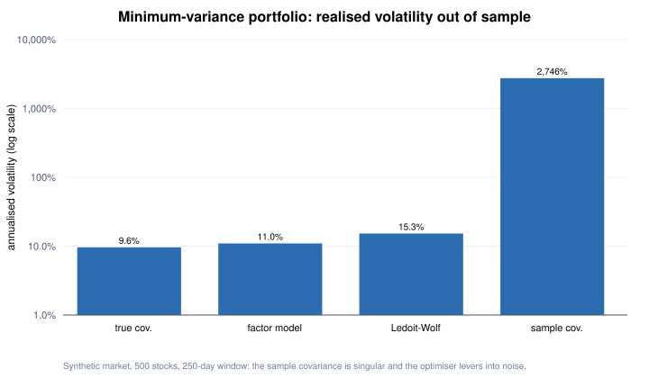
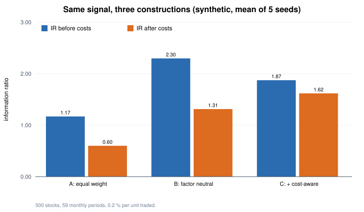
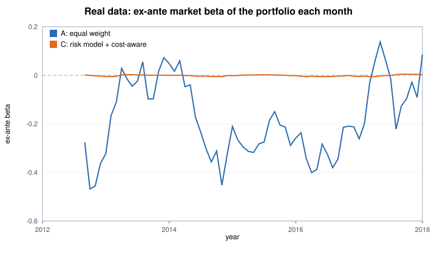

# Part 2 — Risk model and portfolio optimisation

Code: `quantlab/risk_model.py`, `quantlab/optimizer.py`, `quantlab/portfolio_demo.py`. Everything runs on a synthetic market whose true factor
covariance and specific risks are known, so each estimate can be checked against the truth. The last section applies the same machinery
to the signal that passed in Part 1, on real data.

## Why a risk model

A 500-stock covariance matrix has N(N+1)/2 = 125,250 entries. With 250 days of data the sample covariance has rank ≤ 249: it believes some portfolios
are riskless, and an optimiser will lever into exactly those directions. Out of sample (re-estimated every 21 days, past data only):

| Covariance used for the minimum-variance portfolio | Realised annualised vol | Median leverage |
|---|---|---|
| True covariance (benchmark) | 9.6 % | 4.5 |
| Factor model | **11.0 %** | 2.8 |
| Ledoit–Wolf shrinkage | 15.3 % | 5.6 |
| Sample covariance | **2,746 %** | 205 |

A factor model (15 factors) needs 120 factor covariances plus 500 specific variances instead of 125,250 numbers.

## The model (Barra-style)

- **Exposures**: market (all ones), styles (size, value, momentum, volatility; standardised daily) and industry dummies.
- **Daily cross-sectional regression** with weights ∝ √(market cap) (a proxy for 1 / specific variance).
  The market column equals the sum of the industry dummies, so the system is collinear; the usual fix — cap-weighted industry returns sum to zero — is solved with a Lagrange multiplier.
- **Factor covariance**: exponentially weighted (half-life 90 days). **Specific variance**: exponentially weighted squared residuals (half-life 60), shrunk toward the cross-sectional median.
- Estimation error of a factor return ≈ specific vol / √N, so with N = 200 the estimated style returns correlate only 0.75–0.9 with the truth (the self-test checks > 0.7).
- **Testing a risk model**: the bias statistic (std of return / predicted vol) is ≈ 1 for random portfolios under every estimator — random portfolios are easy.
  The hard test is an optimised portfolio, because the optimiser seeks exactly the directions where the model underestimates risk ("error maximisation", Michaud 1989).
- **Risk decomposition**: variance = x'Fx (factor part, x = X'w) + Σ wᵢ²Dᵢ; asset risk contributions wᵢ(Σw)ᵢ/σ sum to σ (Euler).

## The optimiser

maximise α'w − (λ/2)w'Σw − Σκᵢ|wᵢ − w0ᵢ| subject to Aw = b (dollar, factor and industry neutrality) and |wᵢ| ≤ capᵢ.

- **ADMM** in plain NumPy: a KKT linear solve for the quadratic + equality part, a closed-form per-asset step (soft-threshold around w0, then clip) for costs and limits,
  residual-balanced ρ, and OSQP-style **polishing** of the final active set. Linearly dependent constraints are removed by SVD first.
- **Verified three independent ways**: against the closed-form solution (equalities only), against brute-force enumeration of all active sets
  (3⁶ with limits; 5⁵ with costs), and against 300 nearby feasible random points. Halving the soft-threshold (a deliberate bug) is caught.
- α from the signal follows Grinold: α = IC × specific vol × standardised score.

## Same signal, three constructions (`python -m quantlab.portfolio_demo`)

A weak signal (realised rank IC 0.017–0.032) that is partly a "low-volatility" style tilt — as real signals often are. 500 stocks, 59 monthly periods, 0.2 % cost per unit traded:

| Seed | A: equal-weight 10 % long/short — IR gross / net | B: optimised, factor-neutral | C: optimised + costs | Turnover A / B / C |
|---|---|---|---|---|
| 11 | 0.70 / 0.14 | 2.12 / 1.09 | 1.86 / 1.60 | 171 % / 129 % / 36 % |
| 12 | 1.13 / 0.69 | 1.64 / 0.82 | 0.88 / 0.66 | 168 % / 127 % / 36 % |
| 13 | 1.37 / 0.75 | 2.67 / 1.50 | 2.10 / 1.83 | 174 % / 127 % / 37 % |
| 14 | 1.14 / 0.49 | 2.53 / 1.52 | 2.41 / 2.14 | 176 % / 127 % / 36 % |
| 15 | 1.51 / 0.93 | 2.52 / 1.63 | 2.11 / 1.86 | 171 % / 128 % / 38 % |

- Factor neutrality (B) beats equal weighting (A) before costs in every seed: the style tilt added risk (45 % of A's predicted risk was factor risk) but no return.
- Cost-aware optimisation (C) trades about a fifth as much and has the best net IR in 4 of 5 seeds.
- The synthetic market is "clean" (the risk model has the right structure), so real-world gains are smaller; the direction is the point.

This is exactly what the live equal-weight portfolio in Part 1 lacks: its ex-ante beta of about −1.4 is an unintended market bet that a factor-neutral construction would remove.

## Applied to real data: the surviving signal, 2012–2017

The same risk model and optimiser, applied to the mispricing composite that passed in Part 1 (test #2), on real data.

- **Period**: signals formed at the end of 2012-07 … 2017-11 (65 months; holdings run from August 2012 to December 2017).
  It stops before the 2018–2026 confirmation period, and the original test had already looked at these years, so **this is practice, not new evidence**.
- **Data**: free daily prices and the free-data version of the universe, which is **survivorship-biased** (companies that later delisted are missing).
  Each month the three constructions are compared on the same stocks — those with a complete price history (median 642 stocks).
- **Risk model** (daily returns over the 250 trading days before the signal date): market, beta (250-day regression on an S&P 500 ETF),
  size (log of median 60-day dollar volume — the free data has no market capitalisation), momentum (12 months skipping the last), volatility (63-day)
  and industries (first digit of the SIC code; small ones merged). Same estimator as above, weighted by √(dollar volume).
- **Constructions** (monthly, traded at the next day's close; all net of 0.2 % one-way on traded value and 1 %/yr borrow on the short side):
  - **A** — the lab's rule: top 50 long, bottom 50 short, equal weight.
  - **B** — α = 0.02 × specific vol × standardised score (Grinold); zero exposure to market, beta, size, momentum, volatility and every industry;
    |wᵢ| ≤ 2 %; gross exposure 200 %.
  - **C** — B plus transaction costs, starting from last month's holdings. Inside the optimiser the 0.2 % cost is amortised over an expected
    4-month holding period (the alpha persists, so a trade is paid back over several months); realised costs are charged in full. The first month C = B.
    The amortisation was added after the first attempt stopped in its first month (with the full cost against a small alpha the optimiser did not converge).
- **Pipeline check**: construction A on the full universe reproduces the private backtest's monthly returns to within 6 × 10⁻⁷.
- **Data gate**: inside the risk-model window a daily |return| above 100 % is treated as a data error (that day's return set to zero; 29 stock-days in total).
  The first version lacked this gate; adding it moved B's and C's Sharpe ratios by about 0.01 and left A unchanged.

| 2012-08 → 2017-12 | A: equal weight | B: factor neutral | C: + cost-aware |
|---|---|---|---|
| Sharpe ratio before costs | 0.60 | 0.76 | **0.84** |
| Sharpe ratio after costs | 0.34 | 0.03 | **0.39** |
| Annual return after costs | 3.9 % | 0.1 % | 1.4 % |
| Volatility | 11.5 % | 3.5 % | 3.7 % |
| Maximum drawdown (after costs) | −17.4 % | −7.0 % | −5.9 % |
| Realised beta to the S&P 500 | −0.27 | +0.02 | +0.02 |
| Ex-ante beta, median (range) | −0.21 (−0.47 to +0.14) | 0.00 (±0.01) | 0.00 (±0.01) |
| Factor share of predicted risk (median) | 57 % | 0 % | 0 % |
| Traded per month (after the first) | 81 % | 63 % | 25 % |
| Monthly cost incl. borrow | 0.25 % | 0.21 % | 0.13 % |

What it shows:

- **Most of A's risk was not the signal.** 57 % of its predicted risk came from factors, chiefly a market bet that drifted between −0.47 and +0.14.
  A's path is dominated by those bets — its jump and reversal in early 2016 is much smaller in B and C.
- **Neutralising removes risk far more than it adds return.** Volatility falls by two-thirds and the drawdown from −17 % to −6 %;
  the Sharpe ratio before costs rises (0.60 → 0.76–0.84), but the return per unit of gross exposure is smaller, because factor returns are hedged out.
- **A cost-blind optimiser gives it all back.** B trades 63 % a month to earn 2.6 %/yr before costs and ends near zero; C trades 25 % and keeps 0.39.
- **Do not over-read 0.34 vs 0.39.** Over 5.4 years the standard error of a Sharpe ratio is about 0.44; the robust findings are the risk reduction and
  that cost-awareness is not optional. On the synthetic market (above) the gains were much larger — real signals and real risk models are messier.
- The fair comparison is at equal risk: scaled up about three times, C would have A's volatility at its own Sharpe ratio — if borrow, financing and market impact at that size allow it.
