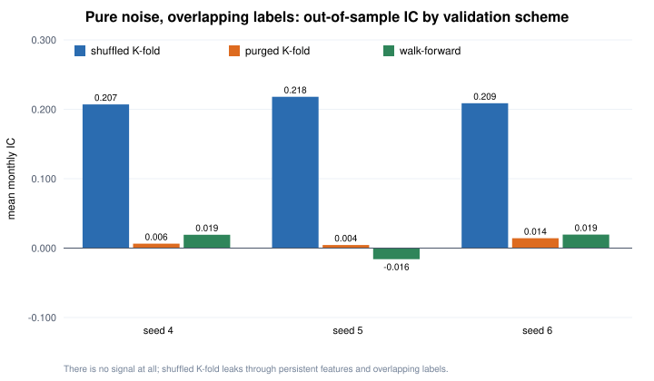
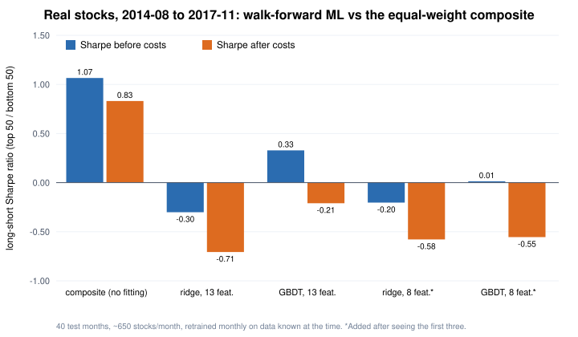
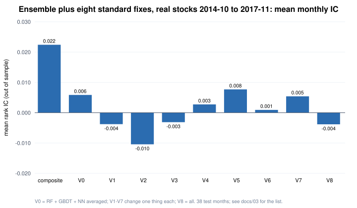

# Part 3 — Machine learning and overfitting

Code: `quantlab/ml_data.py` (synthetic panel), `quantlab/gbdt.py` (histogram gradient boosting + ridge), `quantlab/validation.py`
(purged CV, Newey–West, deflated Sharpe), `quantlab/ml_demo.py`. The panel has 20 persistent characteristics, of which 4 carry signal
(linear, U-shaped and an interaction) with a target IC of 0.06; the rest are noise.

## Gradient boosting from scratch

Features are binned at training quantiles (≤ 32 bins); each node tries every bin edge of every feature and keeps the largest
gain G_L²/(n_L+λ) + G_R²/(n_R+λ) − G²/(n+λ) (for squared loss with λ = 0 this equals the reduction in squared error — checked against brute force).
Boosting fits small trees to residuals with a learning rate and row / column subsampling.

## 1. When does ML beat a linear model?

Walk-forward, out of sample (180 months × 300 stocks):

| Truth | IC of the true signal | Gradient-boosted trees | Ridge |
|---|---|---|---|
| Nonlinear (U-shape + interaction) | 0.061 | **0.034** | 0.023 |
| Linear | 0.062 | 0.045 | **0.055** |

Trees win only when the truth is nonlinear; with a linear truth and 16 noise features, ridge wins. At low signal-to-noise, variance dominates.

## 2. Shuffled cross-validation cheats

Pure noise (no signal at all), overlapping 3-month labels, deeper trees (depth 6, min leaf 5):

| Seed | Shuffled K-fold | Purged K-fold | Walk-forward |
|---|---|---|---|
| 4 | IC **+0.207** (Newey–West t 26.8) | +0.006 (0.8) | +0.019 (1.7) |
| 5 | IC **+0.218** (26.3) | +0.004 (0.5) | −0.016 (−1.5) |
| 6 | IC **+0.209** (28.7) | +0.014 (1.6) | +0.019 (2.3) |

- Persistent characteristics plus overlapping labels put a near-copy of every test row in the training set; deep trees memorise it.
  An IC of 0.21 on pure noise is several times stronger than the best real equity signals.
- **Purging** removes training samples whose label windows overlap the test block; an **embargo** drops a few more after it (López de Prado 2018, ch. 7).
- Monthly ICs are autocorrelated, so t-statistics need a HAC correction (Newey–West here; the research framework uses EWC).
- Even then, walk-forward with only three re-fits produced t = 2.3 on noise once (seed 6): one number is never enough. (Over 24 further seeds,
  purged K-fold with shallower trees averaged −0.001 on noise, positive in 11 of 24 — no bias.)

## 3. The best of many trials

Thirty hyper-parameter sets, keep the best walk-forward result, then test it on fresh data from the same process:

| Data | Best IC / annual IR | P(skill > 0), on its own | Deflated for 30 trials | IC on fresh data |
|---|---|---|---|---|
| Pure noise | +0.007 / 0.34 | 79 % | **30 %** | −0.016 |
| Real signal (IC 0.06) | +0.036 / 1.75 | 100 % | **100 %** | +0.032 |

- Expected maximum Sharpe of N skill-less trials ≈ √V·[(1−γ)Φ⁻¹(1−1/N) + γΦ⁻¹(1−1/(Ne))]; using it as the threshold gives the **deflated Sharpe ratio**
  (Bailey & López de Prado 2014). It is conservative: in simulation the best of 100 skill-less strategies "looks significant" 99 % of the time and passes the deflated test 0 % of the time.
- The 30 configurations here are similar to each other, so the inflation is mild; real research tries far more varied things.
  That is why the research process in Part 1 records **every** test in an append-only registry.

## 4. On real stocks: does ML beat a simple composite?

The same tools on real data: the stocks and signal of Part 2's real-data section (about 650 US large/mid caps a month, free data, a survivorship-biased universe),
signal months 2012-07 → 2017-11. The original test had already seen these years, so this is **practice, not evidence**; 2018 onwards is not touched.

- **13 features**, each converted to a cross-sectional percentile every month: the eight anomaly components of the surviving signal
  plus beta, size, 12-1 momentum, volatility and one-month reversal. **Label**: the percentile of the next holding-period return.
- **Walk-forward with purging on real dates**: a signal formed at the end of month *m* is only fully labelled at the start of month *m + 2*, so test month *t*
  trains on months ≤ *t* − 2 (expanding window, at least 24 months, refitted every month). Test period: 2014-08 → 2017-11, 40 months.
- **Fixed before running and not tuned afterwards**: ridge with α = 10; boosted trees with the synthetic demo's "shallow" settings
  (80 rounds, learning rate 0.1, depth 3, ≥ 50 rows per leaf, 80 % row subsampling).
- Each model's top 50 / bottom 50 are traded like the lab's portfolio (0.2 % one-way, 1 %/yr borrow). The composite's gross returns match Part 2's equal-weight
  portfolio month by month (to within 5 × 10⁻⁷).

| 40 test months | Mean IC (Newey–West t) | Months with IC > 0 | Long–short Sharpe, before / after costs | Monthly turnover | Rank corr. with composite |
|---|---|---|---|---|---|
| **Composite** (equal-weight, no fitting) | **+0.025** (1.58) | 60 % | 1.07 / **0.83** | 80 % | 1 |
| Ridge, 13 features | −0.014 (−0.78) | 45 % | −0.30 / −0.71 | 176 % | 0.33 |
| Boosted trees, 13 features | +0.006 (0.38) | 55 % | 0.33 / −0.21 | 244 % | 0.24 |
| Ridge, 8 components only \* | −0.010 (−0.81) | 48 % | −0.20 / −0.58 | 103 % | 0.51 |
| Boosted trees, 8 components only \* | +0.002 (0.18) | 50 % | 0.01 / −0.55 | 204 % | 0.30 |

\* A diagnostic added after seeing the first three rows (and labelled as such in the code), to separate "the extra price features hurt" from "fitting itself hurt".

- **The fitted models lost to simply averaging the eight components**, with or without the price features. Monthly ICs have a standard deviation of 0.07–0.12
  around a mean of 0.01–0.02, so two to five years of data cannot pin down the weights; equal weighting is shrinkage to a sensible prior and has no estimation error
  (the same reason the 1/N portfolio is hard to beat — DeMiguel, Garlappi & Uppal 2009). Relationships also drift between the training and test years.
- **Turnover finishes the job**: the trees split most often on one-month reversal and momentum, which change every month, so they trade two to three times as much as the composite.
- **Do not over-read it**: with 40 months the standard error of the mean IC is about 0.015, so the gaps are one to two and a half standard errors.
  The defensible statement is "no evidence that ML helped here, and it traded far more", not "ML does not work".
  Where ML does work in the literature (Gu, Kelly & Xiu 2020) it has decades of data, hundreds of features and the whole market.

### Random forest + boosted trees + neural network, averaged

A common practitioner recipe: fit several different models and average their rank predictions. Same data, same walk-forward (40 test months), settings fixed in advance —
a random forest (100 trees, depth 6), the boosted trees above, and a 13 → 32 → 16 → 1 ReLU network (early stopping on the last 12 training months, 5 seeds averaged).
The code is checked first: the network's back-propagation matches numerical derivatives (to 10⁻¹⁰), and on a simulated U-shape both the network and the forest learn the truth
(R² 0.96 and 0.74, ridge 0.22).

| 40 test months | Mean IC (Newey–West t) | Long–short Sharpe after costs | Monthly turnover |
|---|---|---|---|
| **Composite** (no fitting) | **+0.025** (1.58) | **0.83** | 80 % |
| Random forest | −0.005 (−0.26) | −0.21 | 206 % |
| Boosted trees | +0.006 (0.38) | −0.21 | 244 % |
| Neural network | −0.003 (−0.14) | 0.11 | 216 % |
| **Average of the three** | **−0.000** (0.00) | −0.18 | 217 % |
| Average of the three + composite | +0.008 (0.53) | −0.02 | 188 % |

Averaging only cancels errors the models do *not* share; here their monthly ICs correlate 0.57–0.94 (forest vs boosted trees: 0.94) — they fit the same noise.

### Eight standard fixes, pre-specified

Next, the usual remedies, each changing one thing, all fixed (with the selection rule) before running and all reported, on a common 38-month window:

| Variant | Change | Mean IC (t) | Sharpe after costs | Turnover |
|---|---|---|---|---|
| Composite | equal-weight, no fitting | **+0.022** (1.40) | **0.76** | 81 % |
| V0 | three-model average (baseline) | +0.006 (0.34) | −0.10 | 218 % |
| V1 | label minus industry mean | −0.004 (−0.24) | −0.63 | 224 % |
| V2 | features ranked within industry | −0.010 (−0.80) | −1.01 | 222 % |
| V3 | + 12-month changes (21 features) | −0.003 (−0.19) | −0.61 | 223 % |
| V4 | 3-month return label | +0.003 (0.15) | 0.13 | 165 % |
| V5 | learn corrections to the composite | +0.008 (0.46) | −0.14 | 221 % |
| V6 | 3-month smoothing of predictions | +0.001 (0.07) | −0.35 | 116 % |
| V7 | hyper-parameters chosen by validation | +0.005 (0.31) | −0.20 | 243 % |
| V8 | all of the above | −0.004 (−0.33) | −0.82 | 118 % |

- No fix lifted the IC above 0.01. The best net Sharpe (V4, 0.13), deflated for nine tries, has only a 22 % probability of a true Sharpe above zero.
- Longer labels and smoothing halve turnover but add no predictive power. In V5 the models' own noise swamped the composite (rank correlation 0.31):
  model predictions should have been shrunk towards zero — not tried here, because it was not pre-specified.
- More complexity made things worse (V8). With ~650 stocks, five years and 13 features, the models cannot estimate more than an equal-weighted average of known anomalies already captures.
  This matches the literature: Avramov, Cheng & Metzker (2023) find that machine-learning stock-selection profits come mostly from hard-to-trade stocks (microcaps, distressed firms)
  and shrink sharply once those are excluded and trading costs are counted. More data, not fancier models, is what would be needed.

