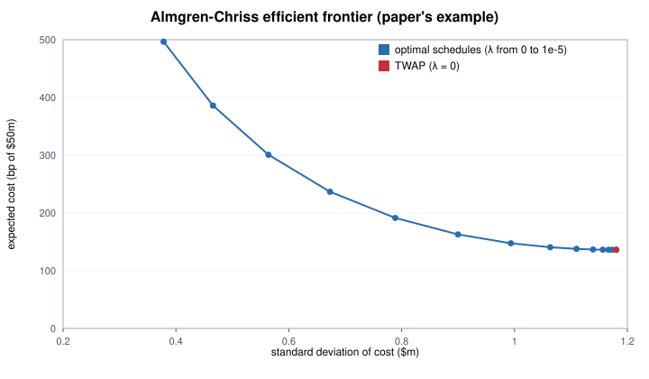
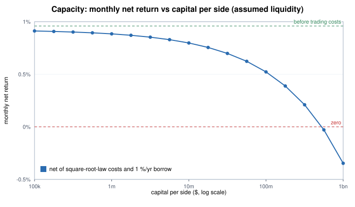
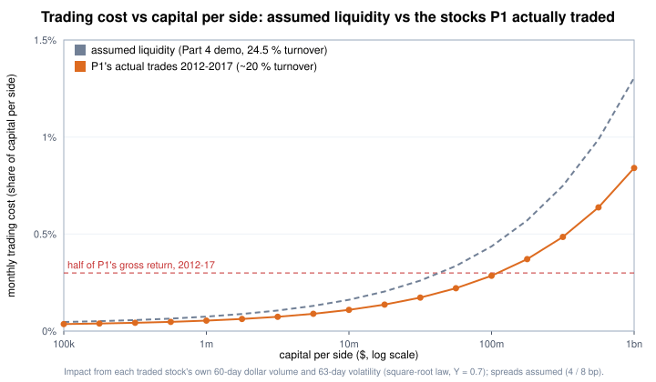

# Part 4 — Execution and transaction costs

Code: `quantlab/execution.py` (`python -m quantlab.execution` runs the demos). Liquidity numbers are assumptions or the original paper's example; no market data.

## Cost of a trade

Half spread + commission + market impact, with impact from the **square-root law** Y·σ_daily·√(Q/ADV) (Y ≈ 0.5–1 empirically; 0.7 here).
For a stock with $50 m daily volume, 2 % daily volatility and a 5 bp spread:

| Order | $10k | $100k | $1m | $10m |
|---|---|---|---|---|
| One-way cost | 5.0 bp | 9.3 bp | 22.8 bp | 65.6 bp |

## Optimal execution (Almgren & Chriss 2000)

Selling fast costs impact; selling slowly risks the price moving away. Minimising E + λV gives x_j = X·sinh(κ(T−t_j))/sinh(κT); λ = 0 is TWAP.
The closed form is checked against a direct tridiagonal solve, and the expected cost and its standard deviation against simulation.
With the paper's example (1 m shares at $50 over 5 days, 20 intervals):

| Strategy | Expected cost | Std of cost | Days to sell half |
|---|---|---|---|
| TWAP (λ = 0) | 136 bp | $1.18 m | 2.50 |
| λ = 10⁻⁶ | 191 bp | $0.79 m | 1.14 |
| λ = 10⁻⁵ | 497 bp | $0.38 m | 0.38 |
| Sell in the first interval | 2,013 bp | 0 | 0 |

There is no single best schedule — only how much cost one pays for less risk.

## Transaction cost analysis

Implementation shortfall (Perold 1988) = delay + execution + opportunity cost + fees; the identity is checked on 200 random cases.
Arrival price is a more honest benchmark than VWAP when one's own order is a large share of the day's volume.

## Capacity

A 50/50 long–short strategy replacing 24.5 % of each side per month at one close, assumed liquidity (median ADV $60 m long / $40 m short, floored at $10 m;
daily vol 2 % / 3.5 %; spreads 4 / 8 bp), against the backtest's gross 1.042 %/month and 1 %/yr borrow:

| Capital per side | Avg one-way cost | Monthly cost | Monthly net | Orders > 10 % of ADV |
|---|---|---|---|---|
| $100k | 4.8 bp | 0.05 % | +0.91 % | 0 % |
| $1m | 7.6 bp | 0.07 % | +0.88 % | 0 % |
| $10m | 16.5 bp | 0.16 % | +0.80 % | 0 % |
| $100m | 44.5 bp | 0.44 % | +0.52 % | 17 % |
| $1bn | 133 bp | 1.31 % | −0.35 % | 94 % |

### Capacity with the stocks the portfolio actually traded

The same calculation with real inputs: every stock the lab's portfolio bought or sold in 2012-08 → 2017-11 (64 months after the initial build, about 40 trades a month;
the number of names replaced each month matches the backtest exactly), each with its own 60-day median dollar volume and 63-day volatility measured before the trade.

- The traded stocks were about as liquid as assumed (median ADV $68 m long / $35 m short vs $60 m / $40 m) and calmer (daily vol 1.5 % / 1.9 % vs 2 % / 3.5 %).
- **Spreads stay assumed (4 / 8 bp).** Estimating them from daily high, low and close prices (Abdi & Ranaldo 2017) was checked by simulation first: the estimator is unbiased,
  but for large caps the spread is tiny next to daily volatility — with 1.5 % daily vol and a 20 bp spread, 3,000 days of data gave 7 bp and it took about 20,000 days to get it right.
  Large-cap spreads need quote data, not free daily bars.
- The portfolio's gross return in this period was 0.60 %/month (1.04 % over the full backtest).

| Capital per side | Avg one-way cost | Monthly trading cost | Monthly net | Orders > 10 % of ADV |
|---|---|---|---|---|
| $100k | 4.5 bp | 0.04 % | +0.48 % | 0 % |
| $1m | 6.7 bp | 0.05 % | +0.46 % | 0 % |
| $10m | 13.6 bp | 0.11 % | +0.41 % | 0 % |
| $100m | 35.7 bp | 0.29 % | +0.23 % | 24 % |
| $1bn | 105 bp | 0.84 % | −0.33 % | 87 % |

Real liquidity tells the same story as the assumptions: costs are small at personal scale (the lab's flat 0.2 % one-way corresponds to roughly $25 m per side),
take half the gross return around $100 m per side, and break even at roughly $300–400 m.

The research's flat 0.2 % one-way assumption is conservative at personal scale; around $100 m per side costs consume about half the gross return.
The backtest trades at the close on the day after the signal date, and live orders would be market-on-close orders on that same day,
so the backtest never computes a signal from a closing price and fills at that same close.
