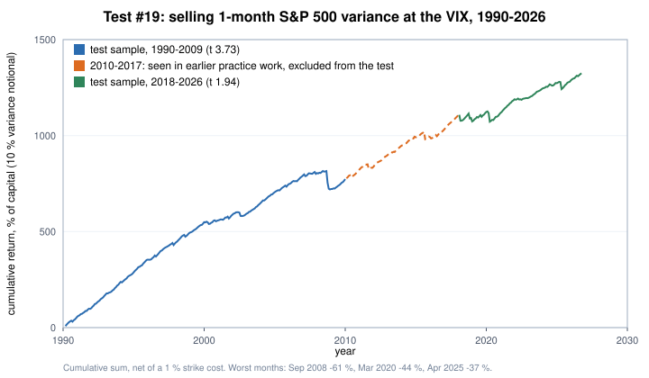
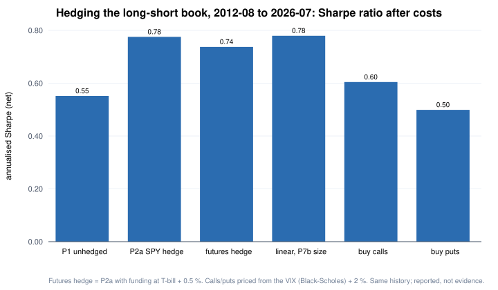

# Part 7 — Derivatives: is the variance risk premium still there, and how should a long–short book be hedged?

Most systematic funds trade derivatives every day, but mostly as **tools** — index futures to hedge or lever a stock book, swaps to short —
not as a separate source of return. The strategies that earn money *from* derivatives themselves (option market making, volatility
arbitrage, dispersion) depend on institutional execution: tight effective spreads, intraday hedging and many contracts at once.
So the question for a small systematic shop is narrower: **what can be tested honestly with public data, and what is it worth in practice?**

This part covers two pieces of work, both run under the same rules as the equity tests in Part 1 (rules written and committed before data, one run):

1. **Test #19 — the variance risk premium.** Is selling one-month S&P 500 variance still profitable after costs, on years this project had not looked at?
2. **Hedging the long–short book (backtest only).** Index futures vs. buying calls vs. buying puts as a hedge for the portfolio of Part 6.

Hypothetical capital of **$5 million** is used only to size contracts and costs; nothing here is a recommendation.

---

## 1. Test #19: selling one-month S&P 500 variance

**Mechanism.** Index options are persistently priced above the volatility that later materialises: buyers pay for crash insurance.
A short variance swap collects that premium directly — it pays the difference between the implied variance at entry (the strike) and the realised variance over the next month.

**Design (fixed before any data was downloaded):**

| | Rule |
|---|---|
| Strike | VIX² at the close of the last trading day of month *m* (only data available at that close) |
| Settlement | realised variance of daily S&P 500 closes over month *m* + 1: RV = (252 / n) Σ ln(Sᵢ / Sᵢ₋₁)² |
| Cost | the vol strike is shaded by 1 % (half of the 1–2 % bid–ask that dealers quote for short-dated variance swaps, Dew-Becker et al. 2017) |
| Size | variance notional = 10 % of capital at the strike; monthly return = 0.10 × (1 − RV / K²) — an excess return, since a swap costs nothing to enter |
| Sample | signal months 1990-01 → 2026-08 (440 months). **2010–2017 excluded from the test**: an earlier practice exercise (Part 5) had already computed this exact strategy on those years. Test sample = 344 months |
| Test | EWC normal-equivalent t of the mean monthly net return > 1.96 (Part 1); promotion at t > 3 |
| Power | Dew-Becker et al. (2017) report an annual Sharpe of 1.4 for one-month variance sold short (1996–2013); halved to 0.7 → 94 % power on 344 months. With a more conservative prior (0.34) power was 41 %, which was accepted explicitly before running |
| Data | VIX from FRED; daily S&P 500 index closes. Both free |

**Result: pass, and promoted** (EWC-equivalent t **4.43**).

| | Test sample (344 months) | 1990–2009 | 2018–2026 (never looked at before) |
|---|---|---|---|
| EWC-equivalent t | **4.43** | 3.73 | **1.94** |
| Mean monthly net return | +2.88 % | +3.24 % | +2.08 % |
| Annualised Sharpe | 1.44 | 1.84 | 0.85 |
| Max drawdown | −76.8 % (across the gap) | −74.1 % (2008) | −49.2 % (2020) |

Robustness (reported, not used for the verdict):
- **Skewness-adjusted t** (Johnson 1978): **2.47**. With skewness −4.9 and excess kurtosis 32, the ordinary t over-rejects: a simulation with 344 months and skewness between −1.9 and −3.7 put its false-positive rate at 3.6–4.9 % instead of 2.5 %. The adjusted t still clears 1.96.
- **Not just market beta**: beta to the S&P 500 is 0.76, but the mean after removing it is still +2.31 % a month (t 4.39).
- **Costs**: t = 4.62 / 4.23 / 3.57 with a 0 % / 2 % / 5 % strike shading; with the usual 2.5× volatility cap, 4.55.
- **Diversification**: correlation with the equity long–short portfolio −0.04.
- 83 % of months are positive; the worst months are September 2008 (−61 %), March 2020 (−44 %), April 2025 (−37 %), October 2008 (−31 %) and February 2018 (−30 %).

**How to read it.**
- The premium is real and large, but it is **insurance selling**: small gains most months, very large losses in crashes. At this size the 2008 drawdown was about three-quarters of capital.
- The most recent years are weaker (Sharpe 0.85, t just under 1.96 on their own).
- This is a **replication** of a well-documented effect, chosen from the literature — under the project's rules it is not evidence for trading.
- The instrument is **synthetic**: a one-month variance swap struck at the VIX is an over-the-counter contract that an individual account cannot trade.

## 2. The test that was designed but not run

The tradable version for an individual is to **sell listed S&P 500 index options and hedge their delta daily with index futures**, at real bid and ask prices.
That test (#20) was fully specified and reviewed — sell a ~5 % out-of-the-money put each month at the bid, re-hedge to delta-neutral every day,
buy back at the ask the day before expiry, judged on 2007–2009 and 2018–2026 — but it needs a commercial end-of-day options dataset (about $600, roughly 500 GB),
and the decision was **not to buy it**. Registered, not run, recorded as such.

Two design lessons from its review are worth keeping:
- **A data filter can be a hidden look-ahead.** The first draft imported only strikes near the money. When the index fell more than 5 %, the sold put went in the money,
  dropped out of the filtered data, and the code treated it as "missing" and closed early — a stop-loss that knew the future. On simulated paths it turned a −2.9 % crash month into +0.1 %.
  The fix: import a wide strike range (60–160 % of spot) and never move the exit date because a row is missing.
- **Units and licences need explicit checks.** Rates were checked for percent vs. decimal by their maximum, not their median (low-rate years made the median ambiguous),
  and no quote from a licensed dataset would have gone into a published file.

## 3. Hedging the long–short book (backtest only)

The equity portfolio of Part 6 has a **negative market beta** most of the time (145 of 167 months on its own 252-day estimate), and its worst months are **sharp market rallies**:
four of its five worst months came when the S&P 500 rose 5–8 % and the short side jumped 12–17 %. That decides which hedges make sense.

| Variant | Sharpe (net) | Max drawdown | What it is |
|---|---|---|---|
| P1 | 0.55 | −39.8 % | unhedged long–short |
| P2a | 0.78 | −35.9 % | beta hedged with SPY (beta from 252 days) |
| Futures hedge | 0.75 / 0.74 / 0.73 | −36.1 % to −36.2 % | P2a with the hedge in index futures, funding at T-bill + 0 / 0.5 / 1.0 % |
| Linear, same size as calls | 0.78 | −35.3 % | P1 + long index exposure sized by the negative beta (control) |
| Buy calls | 0.60 | −38.9 % | P1 + one-month at-the-money index calls sized by the negative beta |
| Buy puts | 0.50 | −40.9 % | P1 + one-month 5 % out-of-the-money index puts, same size |

- **Futures are the practical hedge.** Paying for futures funding (the financing cost embedded in the futures price) takes the Sharpe ratio from 0.78 to 0.73–0.75; most of the benefit of hedging survives.
  At $5 million the hedge is roughly **7 E-mini contracts** (median; ~73 micro E-minis), adjusted monthly and rolled quarterly.
- **Convexity was not worth the premium.** Calls paid back about what they cost (about +4 % of capital in total over 145 months) and did worse than the linear hedge of the same size
  (−0.21 % a month, t −3.4) — in this period the linear hedge also earned the market's own return.
- **Puts are the wrong hedge for this book.** The portfolio makes money when the market falls; protection against falls is insurance it does not need (about −10 % of capital in total).
- **Hedge plus position sizing.** Adding the market-volatility scaling of Part 6 (P6) on top of the futures hedge gave a Sharpe ratio of 0.82 and cut the maximum drawdown from −36 % to −23 %; the gain in return over the hedge alone was not significant (t 0.9), and the smaller drawdown partly reflects a 252-day volatility window that happened to cover March 2020. The combination was chosen after seeing both parts, so it is reported, not used.
- All variants use the same 2012–2026 history as the original backtest; they are reported, not evidence, and not used to pick a portfolio.

## 4. What I took away

1. **Derivatives are mostly tools.** For a long–short equity book the most useful derivative is the plain index future — cheap, capital-efficient, and easy to size.
2. **Risk premia in options are real, but tail-heavy and hard to harvest small.** The variance premium passed a pre-registered test with t 4.4, yet one month can cost 60 % at a modest size,
   and the version an individual can trade needs paid data, daily hedging and tight execution.
3. **Data cost is a design constraint.** The cleanest test of tradability was written and reviewed but not run because the data was not worth its price to the project — and that is recorded, not hidden.

### References
- Carr, P. & Wu, L. (2009), *Variance Risk Premiums*, Review of Financial Studies.
- Dew-Becker, I., Giglio, S., Le, A. & Rodriguez, M. (2017), *The Price of Variance Risk*, Journal of Financial Economics (NBER WP 21182).
- Daniel, K. & Moskowitz, T. (2016), *Momentum Crashes*, Journal of Financial Economics.
- Johnson, N. J. (1978), *Modified t Tests and Confidence Intervals for Asymmetrical Populations*, JASA.
- Israelov, R. (2019), *Pathetic Protection: The Elusive Benefits of Protective Puts*, AQR.
