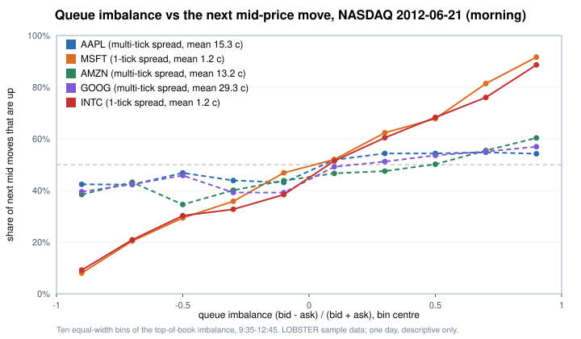

# Part 9 — Market microstructure: a C++ order book, order-book signals, intraday rules

*October 2026. Practice work, not part of the test registry. Data: the free LOBSTER sample (NASDAQ, 21 June 2012, five stocks, ten levels) and
Binance BTC/USDT and ETH/USDT one-minute bars (each monthly file checked against the exchange's published SHA-256). Raw data are not redistributed;
`data/` holds only counts, timings and aggregate statistics — no prices.*

This part covers three pieces of work:

1. **A price–time-priority limit order book in C++17**, checked three ways and replayed against 2.1 million real NASDAQ events.
2. **Three classic short-horizon order-book signals** — order-flow imbalance, queue imbalance and the micro-price — on the same NASDAQ day.
3. **Intraday momentum and reversal rules on crypto bars**, with the rule chosen on 2019–2021 and tested once on 2022–2024.

---

## 1. A limit order book in C++

**Design** (`cpp/orderbook.hpp`, header-only):

| Choice | Why |
|---|---|
| One `std::map` per side keyed by integer price ticks | the best price is always `begin()`; no floating point inside the book; O(log P) for a new level |
| A FIFO queue (`std::list`) per price level | time priority; stable iterators, so an order in the middle of a queue can be removed in O(1) |
| `std::unordered_map` from order id to (side, price, iterator) | O(1) cancel and reduce by id |
| Trades print at the resting order's price | the standard rule; the aggressor's limit only bounds which levels it can reach |

Rules: limit orders trade against the opposite side best price first and first come first served at a price, and any remainder rests at its own price;
market orders sweep and drop their remainder; reduce keeps queue priority; a duplicate live id or a non-positive price or size is rejected.

**How we know it is right — three layers.**

1. **21 hand-worked unit tests** (`cpp/tests.cpp`): time priority, price priority, partial fills, sweeps, reduce keeping priority, empty levels removed, bad input rejected.
2. **Differential testing.** The same random order flow (limit, market, cancel and reduce; three runs of 20,000 commands) goes to the C++ engine (`cpp/engine_cli.cpp`) and to an
   independently written Python reference (`quantlab/orderbook.py`). Every trade and the top-five book after every command must be **identical, character for character**;
   the C++ side also asserts that the book never crosses. Two independent implementations agreeing over tens of thousands of steps is hard to achieve by accident.
3. **Real data.** LOBSTER's message file only contains events inside the ten visible levels, so the book cannot be rebuilt from messages alone.
   Instead each event is checked on its own (`cpp/lobster_check.cpp`): take the official book after event *k − 1*, apply event *k* with our rules,
   and compare with the official book after event *k* (when our update empties a level, the official book pulls in a level from outside the window that cannot be known, so only the known levels are compared).

| Stock | Events checked | Matching the official book | C++ time |
|---|---|---|---|
| AAPL | 400,390 | 400,390 | 1.4 s |
| MSFT | 668,764 | 668,764 | 2.5 s |
| AMZN | 269,747 | 269,747 | 1.1 s |
| GOOG | 147,915 | 147,915 | 0.7 s |
| INTC | 624,039 | 624,039 | 2.5 s |
| **Total** | **2,110,855** | **all** | |

**Speed** (`cpp/bench.cpp`; one core of an Apple-silicon laptop, clang −O2, one million operations of the same random flow):

| | Throughput | Latency per operation |
|---|---|---|
| C++ book | ~15.2 million operations / s | median 42 ns, p99 208 ns, p99.9 292 ns, worst 0.36 ms |
| Python reference (same rules) | ~0.65 million operations / s | — |

- The C++ book is about **23× faster**. On the LOBSTER replay it is only about 3.5× faster (AAPL: 1.4 s vs 5.0 s), because most of that time is reading files —
  **measure before deciding where the bottleneck is**.
- The worst operation is thousands of times slower than the median: scheduling, page faults, allocation and hash-table growth. Production engines remove that tail with
  pre-allocation, object pools, pinned cores and price-indexed arrays instead of trees.
- Timing method: a monotonic clock, throughput and per-operation timing in separate runs (the timer costs tens of nanoseconds), and both runs must end in the same book.

## 2. Order-book signals on one NASDAQ day

Top of book only; parameters fitted 9:35–12:45, checked 12:45–15:55 (the first and last five minutes dropped). One day, so this is description, not a strategy.

1. **Order-flow imbalance** (Cont, Kukanov & Stoikov 2014): each book update adds bid-side pressure (a higher or larger best bid) minus ask-side pressure;
   summed over 10-second windows, the mid-price change is close to linear in it, with a slope inversely related to depth.
2. **Queue imbalance** I = (bid size − ask size) / (bid size + ask size): the larger the bid queue relative to the ask queue, the likelier the next mid move is up.
3. **Micro-price** (the simplest version) m = (ask · bid size + bid · ask size) / (bid size + ask size), compared with the mid as a forecast of the mid 10 seconds later.

| Stock | Mean spread | OFI R² (morning fit / afternoon, same slope) | Next move up: lowest → highest imbalance bin | Afternoon hit rate, sign of I | Micro-price error ÷ mid error (10 s) |
|---|---|---|---|---|---|
| MSFT | 1.2 ¢ (one tick 77 % of the time) | 0.78 / 0.77 | 8 % → 92 % | 67 % | 0.88 (better) |
| INTC | 1.2 ¢ (78 %) | 0.77 / 0.40 | 9 % → 89 % | 67 % | 0.89 (better) |
| AAPL | 15.3 ¢ | 0.38 / 0.49 | 42 % → 54 % | 56 % | 1.09 (worse) |
| AMZN | 13.2 ¢ | 0.30 / 0.36 | 38 % → 60 % | 59 % | 1.19 (worse) |
| GOOG | 29.3 ¢ | 0.09 / 0.24 | 40 % → 57 % | 57 % | 1.37 (worse) |

- **Large-tick stocks** (low price, spread almost always one tick: MSFT, INTC): the queues carry a lot of information — imbalance nearly decides the next move, and the micro-price beats the mid.
- **Small-tick stocks** (high price, multi-tick spreads: AAPL, AMZN, GOOG): the top level is a thin slice of the book and refills quickly; the signals are much weaker and the naive
  micro-price is *worse* than the mid — the motivation for Stoikov's (2018) more careful micro-price.
- Even at 67 % accuracy a move is one tick (1 ¢), while taking liquidity costs half the spread plus fees. These signals tell a **market maker** where to quote and when to cancel;
  they are not a reason to cross the spread.

## 3. Intraday momentum and reversal on crypto bars

**Rules, fixed before looking at the data.** One-minute closes aggregated to h-minute bars on the UTC clock, h ∈ {5, 15, 60, 240}; rule direction ∈ {momentum, reversal};
position at a bar's close = direction × sign(that bar's return), held one bar; a flip costs 2 units of turnover. Eight rules in all. **Train 2019–2021, test 2022–2024**:
choose the rule with the best training Sharpe at 5 bp per side, then look at the test period once. Code: `quantlab/microstructure.py` (`to_bars`, `bar_returns`, `sign_rule`).

| | BTC | ETH |
|---|---|---|
| 5-minute return autocorrelation, train → test | −0.036 → −0.023 | −0.037 → −0.010 |
| 5-minute reversal, Sharpe before costs, train → test | 6.8 → 1.7 | 3.2 → 0.4 |
| 5-minute reversal: flips per day; break-even cost (train) | ~300; 0.5 bp per side | ~300; 0.3 bp per side |
| Chosen rule (best training Sharpe at 5 bp — still negative) | 4-hour reversal (−0.83) | 4-hour reversal (−0.27) |
| Chosen rule in the test period at 5 bp | **−1.64** (NW t −3.0) | **−1.90** (NW t −3.4) |
| Deflated Sharpe ratio of the choice (8 tried) | 0.00 | 0.00 |
| Hour-of-day mean returns, correlation train vs test | −0.10 | −0.09 |
| 5-minute **absolute** return autocorrelation (train) | 0.39 | 0.39 |

- **Short-horizon reversal is real but small and fading**, and its break-even cost (well under 1 bp per side) is far below what a taker pays. All eight rules lose at 5 bp.
- **Intraday seasonality did not persist**: the best hour in training ranked 16th of 24 in the test period.
- **Volatility is predictable, direction barely is** (absolute-return autocorrelation 0.39 vs return autocorrelation −0.04): position sizing and risk limits can use it; directional taking cannot.
- The same lesson as the statistical-arbitrage test in Part 8 (t 2.76 before costs, −0.06 after): at short horizons, costs and execution decide everything.

## What this part shows

- **Engineering:** a correct, fast order book in modern C++, and a verification habit — hand tests, differential testing against an independent implementation, replay against real exchange data.
- **Research:** the classic microstructure signals reproduced, with the tick-size effect that decides when they work; and a clean train / test protocol that turns
  "5-minute reversal earns a Sharpe of 6.8" into "not tradable after costs".
