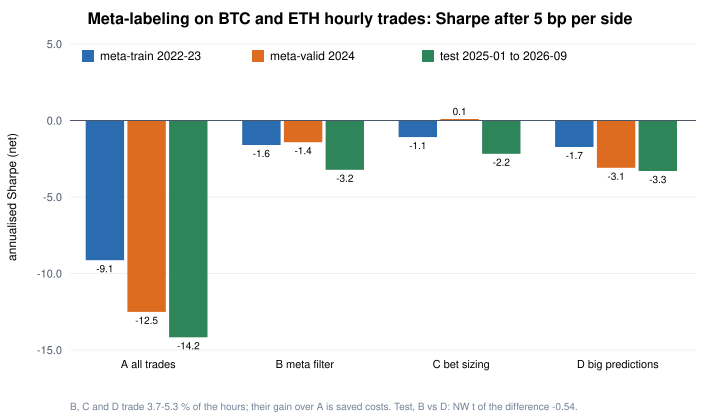

# Part 10 — Deep learning and meta-labeling on crypto

*October 2026. Practice work, not part of the test registry. Data: Binance BTC/USDT and ETH/USDT one-minute bars, 2019-01 → 2026-09
(every monthly file checked against the exchange's published SHA-256; not redistributed). Each design — features, models, splits, the rule for choosing — was fixed in code
before the results were computed, and each test period was looked at once. `data/` holds only aggregate statistics.*

Two questions on the same problem — **predict the next hour's return of BTC and ETH from 15-minute bars**:

1. Do deep networks (an MLP and an LSTM) beat a ridge regression and gradient-boosted trees?
2. Can a **meta-labeling** filter (López de Prado 2018) turn a weak directional model into one that pays its costs?

---

## 1. Ridge vs trees vs MLP vs LSTM

**Set-up.** 15-minute bars on the UTC clock. Target: the log return over the next four bars (one hour), one model per coin.
22 features using data up to the bar's close only: both coins' returns over the past 1, 2, 4, 8, 16, 32 and 96 bars; volatility over 16 and 96 bars; volume relative to its one-day average;
hour of day (sine, cosine). The LSTM instead reads the last 32 bars of four series (both coins' returns and absolute returns). Rows with any missing bar in their window are dropped.
**Train 2019–2020 (68,477 rows), validation 2021 (34,370; only for early stopping and the ridge penalty), test 2022–2024 (105,106; looked at once).**
Features standardised with training-period statistics only. The trading rule for evaluation: every hour, position = sign of the prediction, held one hour.

Models: ridge (penalty chosen on validation), gradient-boosted trees (`quantlab/gbdt.py`, fixed settings), an MLP and an LSTM in PyTorch (`extras/torch_models.py`;
early stopping on validation; fixed seeds and deterministic algorithms, so a rerun gives bit-identical predictions), and the equal-weight average of the four.

**Test period 2022–2024:**

| | BTC IC | monthly IC, NW t | Sharpe before costs | Sharpe at 5 bp | break-even | ETH IC | monthly IC, NW t | Sharpe before costs | Sharpe at 5 bp | break-even |
|---|---|---|---|---|---|---|---|---|---|---|
| Ridge | **0.042** | 6.4 | 1.0 | −2.8 | 1.3 bp | **0.054** | 10.1 | 1.0 | −2.7 | 1.3 bp |
| Boosted trees | 0.016 | 3.9 | 1.2 | −4.0 | 1.1 bp | 0.025 | 5.8 | 0.7 | −4.0 | 0.7 bp |
| MLP | 0.025 | 4.4 | 1.4 | −2.5 | 1.8 bp | 0.027 | 6.3 | 0.9 | −2.4 | 1.4 bp |
| LSTM | 0.038 | 6.9 | 0.4 | −6.5 | 0.3 bp | 0.030 | 7.9 | 1.4 | −3.2 | 1.5 bp |
| Average of the four | 0.038 | 6.3 | 0.9 | −3.9 | 0.9 bp | 0.046 | 11.3 | 1.3 | −2.8 | 1.6 bp |

**Rank IC, train → validation → test** (overfitting shows up as a large first number and a small last one):

| | BTC | ETH |
|---|---|---|
| Ridge | 0.095 → 0.015 → **0.042** | 0.094 → 0.035 → **0.054** |
| Boosted trees | 0.148 → 0.025 → 0.016 | 0.178 → 0.050 → 0.025 |
| MLP | 0.101 → **0.037** → 0.025 | 0.110 → **0.053** → 0.027 |
| LSTM | 0.074 → 0.025 → 0.038 | 0.062 → 0.022 → 0.030 |

- **The direction is slightly predictable, and the effect is real**: every model has a positive IC in three unseen years, with monthly-IC t-statistics between 3.9 and 11.3 (36 months).
- **It does not pay**: flipping every hour, the break-even cost is 0.3–1.8 bp per side; at 5 bp every model loses.
- **The simplest model wins.** The boosted trees fit training best and test worst; the validation period picked the MLP, which came third of four in the test period —
  a one-year validation period is noisy, which is exactly why the test period may not be used to choose again.
- What ridge learned is textbook: one-to-eight-hour **reversal** in BTC, one-day **momentum** from ETH, a volatility term and an hour-of-day term.
- On low signal-to-noise problems with ~200,000 rows, model capacity is not the bottleneck; features, validation and costs are. Deep learning earns its keep with much more data
  and richer structure (order-book event streams, text, large cross-sections with interactions).

## 2. Meta-labeling: can a filter rescue the ridge model?

**Idea.** Split "which side" from "whether and how much". The primary model (the ridge above, unchanged and re-verified coefficient by coefficient) only gives a side.
Each hourly trade is labelled with the **triple-barrier** method, and a secondary **meta model** learns the probability *p* that following the primary model on that trade makes money after costs.
Code: `quantlab/meta_labeling.py`.

**Rules, committed before downloading the 2025–2026 data:**

- Events: every hour on the hour, each coin; entry at the bar's close.
- Triple barrier: ±1 × σ (σ = one day of 15-minute returns, scaled to an hour), checked on one-minute closes; otherwise exit after 60 minutes.
  Label = 1 if the trade made money after a 10 bp round trip.
- Meta model: 11 features known at entry (the primary's |prediction|, side, coin, log σ, short/long volatility ratio, the trade's direction relative to the last hour's and last day's move,
  volume, hour of day, whether the other coin's primary signal agrees). L2 logistic regression (penalty chosen on 2024) or the boosted trees — whichever has the lower 2024 log loss
  (it was the logistic regression).
- **Meta-train 2022–2023** (never seen by the primary model), **meta-validation 2024**, **test 2025-01 → 2026-09: new data nobody had looked at, looked at once.**
- Policies: **A** every trade; **B** only when *p* > 0.5 (the label already nets costs, so no threshold was tuned); **C** bet size 2Φ(z) − 1 with z = (p − 0.5)/√(p(1 − p));
  **D** only when the primary's own |prediction| is large, at the same trade share as B — the control that asks whether the meta model learned anything beyond "big predictions are better".
  Each coin is accounted separately (a same-side trade right after a 60-minute exit pays no new cost), at 5 bp per side, then the two coins are averaged.

**The meta model:**

| | meta-train 2022–23 | meta-valid 2024 | **test 2025-01 → 2026-09** |
|---|---|---|---|
| Hourly events per coin | 17,493 | 8,783 | 15,311 |
| Primary model's hit rate | 52.6 % | 51.8 % | 51.2 % |
| Share of labels = 1 | 40.7 % | 41.8 % | 39.6 % |
| AUC (logistic) | 0.588 | 0.556 | **0.563** |
| Log loss (base-rate log loss) | 0.666 (0.676) | 0.675 (0.680) | 0.666 (0.671) |
| *p* > 0.5: share taken, precision, recall | 5.3 %, 49.3 %, 6.4 % | 3.8 %, 50.4 %, 4.6 % | 3.7 %, 46.1 %, 4.3 % |

In the test period the probabilities are well calibrated (by quintile of *p*: 0.34 → 0.32, 0.38 → 0.36, 0.40 → 0.40, 0.43 → 0.44, 0.48 → 0.46).

**The policies (both coins, 5 bp per side):**

| Policy | Segment | Share of hours traded | Gross / net per unit (bp) | Sharpe before costs / at 5 bp |
|---|---|---|---|---|
| A every trade | meta-valid | 100 % | 0.0 / −5.7 | 0.03 / −12.5 |
| A every trade | **test** | 100 % | **−0.5 / −6.1** | **−1.22 / −14.2** |
| B meta filter | meta-valid | 3.8 % | 3.2 / −6.5 | 0.70 / −1.4 |
| B meta filter | **test** | 3.7 % | **−5.1 / −14.7** | **−1.14 / −3.2** |
| C bet sizing | **test** | 3.7 % | −8.3 / −18.1 | −1.01 / −2.2 |
| D big predictions | **test** | 4.0 % | −3.0 / −12.5 | −0.81 / −3.3 |

**What it means.**

1. **The primary model had no gross edge in the new data** (−0.5 bp per unit before costs in 2025–26, hit rate 51.2 %). Meta-labeling can select; it cannot create.
2. **A cost-netted label teaches the meta model volatility.** Its largest coefficient is log σ. With a fixed 10 bp cost, a bigger move clears the cost more often whatever the side:
   in the meta-training period, the share of labels = 1 rises from 30 % to 46 % (BTC) across volatility quintiles while the primary's hit rate only goes from 51.1 % to 53.6 %.
   So an AUC of 0.56 is mostly "will the hour move enough", not "is the side right" — precision rose, average return did not.
   (`quantlab/meta_labeling.py` reproduces the effect on a coin-flip side in its self-test.)
3. **"B beats A with t = 19" is not evidence**: B trades 3.7 % of the hours, so it simply pays less in costs. The right comparison is D, which trades as often:
   B − D has t = −0.54 in the test period. The validation year's B − D t of 2.26 did not survive.
4. **What would give meta-labeling a chance**: a primary model with a gross edge; labels on direction (or volatility-scaled returns) with costs applied at the sizing step;
   cheaper execution (passive orders, fee rebates). Filtering cannot rescue a signal whose break-even cost is one or two basis points.
